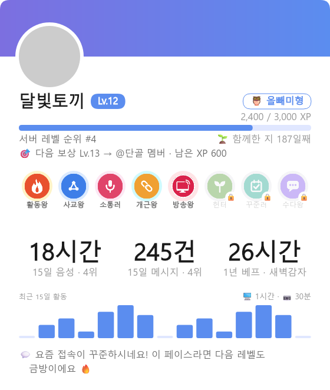
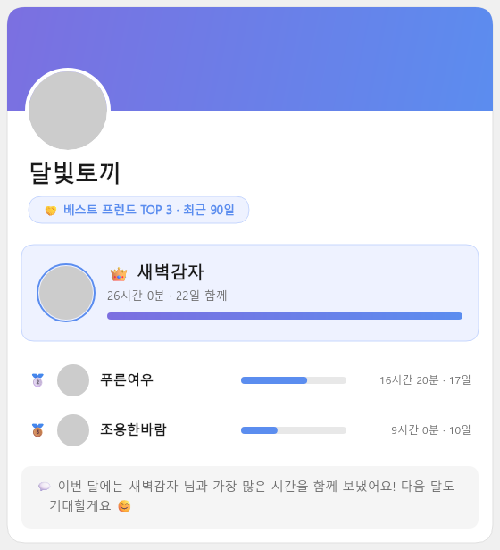

# Onyu Bot


**🌐 라이브 서비스: [onyu.dev](https://onyu.dev)** — 봇 초대와 웹 대시보드는 사이트에서 이용할 수 있습니다.

디스코드 서버의 음성 채널 활동을 실시간 추적하고, 레벨·랭킹·프로필 카드, 친구·궁합 카드,
Gemini 기반 AI 관리 도우미, 신규사용자 온보딩, 자동 음성채널, 고정 메시지, 역할 패널 등을 제공하는
다목적 디스코드 봇의 **클라이언트(봇 프로세스) 코드**입니다.

| 항목 | 내용 |
|---|---|
| 역할 | 1인 개발 — 기획 · 설계 · 구현 · 운영 · 배포 전 과정 |
| 기간 | 2024-11 ~ 현재 (라이브 운영 중, 2026-11 기준 v1.89) |
| 원본 | private 모노레포 `sambart/onyu` (api · bot · web 3앱) — 커밋 3,600+ · 릴리즈 태그 160+ |
| 이 리포 | 그중 **bot 앱 + 공유 라이브러리**를 자동 추출한 **읽기 전용 미러** (2026-07 ~) |

> **이 레포는 Bot 클라이언트 코드만 포함합니다.** 비즈니스 로직(DB, AI 분석, 웹 대시보드 API 등)은
> 별도의 Private API 서버가 담당하며, 이 레포는 코드 열람/포트폴리오 목적으로 공개된
> **읽기 전용 미러**입니다 (PR/Issue를 받지 않습니다). 별도 API 서버 없이는 봇이 단독으로 동작하지 않습니다.
> 커밋 히스토리는 원본의 릴리즈 단위 스냅샷이며(squash), 각 커밋 메시지에 해당 릴리즈의 봇 변경 목록을 싣습니다.

## 미리보기

봇이 슬래시 커맨드 응답으로 보내는 이미지 카드입니다 (렌더링은 API 서버, 봇은 첨부로 응답).

<p align="center">
  
  
</p>

## 아키텍처

```
                        ┌─────────────── Private ───────────────┐
Discord ◄──gateway──►  Bot (이 레포)  ──HTTP──►  Onyu API 서버  ──►  PostgreSQL / Redis
                                                     │
                                                     ├──►  Google Gemini (AI 분석 · 관리 도우미)
                        Web Dashboard  ◄─────────────┘
```

Bot은 **얇은 클라이언트(thin client)** 로 설계되어 있습니다 — Discord 게이트웨이 이벤트 수신과
응답 렌더링만 담당하고, 상태 저장과 비즈니스 로직은 전부 API 서버에 HTTP로 위임합니다.

- **장애 격리 / 배포 독립성** — 봇 재시작·재배포가 데이터 파이프라인(집계·분석)에 영향을 주지 않음
- **타입 세이프 API 계약** — Bot ↔ API 통신은 [`libs/bot-api-client`](libs/bot-api-client) HTTP SDK(메서드 50+)로 캡슐화,
  요청/응답 타입은 [`libs/shared`](libs/shared)에서 단일 정의
- **무상태(stateless)** — Bot 프로세스는 자체 DB/Redis 없이 동작. 단일 프로세스(샤딩 없음)

## 주요 기능

- **음성 채널 활동 추적** — 입장/퇴장/이동/마이크 on-off 이벤트 실시간 수집 후 API로 전달
- **레벨 시스템** — 음성·메시지 활동 기반 레벨, 랭크 카드(`/랭크`)와 서버 리더보드(`/랭킹`)
- **프로필 카드** — 레벨 · 음성 활동 · 뱃지 컬렉션 · 연말 결산 4종 뷰(`/미`)
- **친구 · 궁합 카드** — 함께 접속한 시간 기반 베스트 프렌드 TOP(`/친한친구`), 오늘의 랜덤 궁합(`/궁합`)
- **AI 관리 도우미** — 관리자가 자연어로 서버 설정·활동 분석을 질의(`/관리도우미`, Gemini)
- **신규사용자 온보딩** — 입장 감지, 환영 메시지, 미션 추적, 신입 기간 만료 시 역할 정리
- **자동 음성채널 생성** — 트리거 채널 입장 → 버튼 선택 → 확정방 생성·이동, 전원 퇴장 시 자동 삭제
- **고정 메시지(Sticky Message)** — 채널 최하단 메시지 고정 (디바운스 재게시, 웹 대시보드 연동)
- **게임방 접두사(Status Prefix)** — 버튼으로 닉네임 접두사 변경, 퇴장 시 자동 복원
- **역할 패널(Role Panel)** — 버튼 클릭으로 역할 부여/토글 (동시 클릭 락 처리)
- **메시지 집계 · 사용성 집계** — 텍스트 활동과 기능 사용 이벤트를 집계용으로 전달
- **동시 접속 추적(Co-Presence)** — 음성 채널 동시 접속 스냅샷 주기 수집
- **봇 모니터링** — health · liveness · Prometheus 메트릭 엔드포인트, 30초 주기 헬스 스냅샷 push

## 슬래시 커맨드

커맨드 이름·설명·옵션은 Discord 로케일에 따라 현지화됩니다 (영문 기본, 한글 이름 병기).

| 커맨드 | 설명 |
|---|---|
| `/me` (`/미`), `/profile` (`/프로필`) | 프로필 카드 — 보기 옵션: 레벨(기본) · 음성 · 결산 · 뱃지 |
| `/rank` (`/랭크`) | 내 또는 다른 멤버의 레벨 랭크 카드 |
| `/leaderboard` (`/랭킹`) | 서버 레벨 리더보드 (페이지 옵션) |
| `/best-friend` (`/친한친구`) | 함께 접속한 시간 기반 베스트 프렌드 TOP 카드 (상대 지정 시 1:1 케미) |
| `/ship` (`/궁합`) | 멤버와 오늘의 랜덤 궁합 카드 |
| `/admin-assist` (`/관리도우미`) | 서버 설정·활동 분석에 대해 자연어로 질의 (관리자 전용) |
| `/sticky-list`, `/sticky-delete` (`/고정메세지목록`, `/고정메세지삭제`) | 고정 메시지 조회 · 채널 단위 삭제 |
| `/help` (`/도움말`) | 주요 기능 안내 |
| `/version` | 봇 버전 |

## 기술 스택 & 엔지니어링 포인트

- **Runtime**: Node.js 20 + NestJS 10 (모듈러 아키텍처 + DI) · discord.js 14 + discord-nestjs 5
- **Language**: TypeScript 5 (strict, `any` 금지 · floating promise 금지 등 ESLint 9 flat config)
- **i18n**: [`libs/i18n`](libs/i18n) — ko · en 완역, ja · pt-BR 부분 번역(누락 키는 en 폴백).
  인터랙션 locale 기반 해석, 커맨드 이름·설명·옵션까지 현지화. 로케일 커버리지는 테스트로 강제
- **커스텀 ESLint 룰 2종** — 로케일 리터럴 분기(`=== 'ko'`)·하드코딩 한글 금지([`eslint.i18n-rules.mjs`](eslint.i18n-rules.mjs)),
  길드 소속 검증을 거치지 않은 채널 메시지 전송 금지([`eslint.discord-rules.mjs`](eslint.discord-rules.mjs)) — 리뷰에서 반복 발견된 결함을 정적 검사로 차단
- **테스트**: vitest — spec 파일 80+, 테스트 코드 약 2.0만 줄(소스 약 1.8만 줄). 이 리포의 CI 가 push 마다 lint · tsc · test · build 를 실행
- **복원력**: API 호출 실패 로그 표준화(토큰·헤더 미포함), 메시지 전달 지터 재시도, 스케줄러 예외 흡수 후 다음 주기 자연 복구
- **관측성**: pino 구조화 로깅(nestjs-pino) · prom-client `/metrics` · `/health`, `/health/liveness` · Sentry
- **스케줄러 3종**: 동시접속 스냅샷(60초) · 헬스 스냅샷 push(30초, API 측 TTL 이 dead-man switch) · 봇 디렉터리 서버 수 보고(30분)
- **빌드/배포**: pnpm workspaces + 멀티스테이지 Docker. 원본 모노레포는 `main` push 시 semver 태깅 → 이미지 빌드 → 서버 배포 → 헬스체크 실패 시 자동 롤백까지 자동화
- **공개 미러 파이프라인**: 원본 `main` push 시 GitHub Actions 가 봇 관련 파일만 추출해 이 리포에 push — 내부 전용 타입 트리밍, 개인 핸들 치환, 민감 문자열 회귀 스캔(발견 시 미러 중단)

## 시작하기

### 사전 요구사항

- Node.js 20 (>= 18)
- pnpm 10
- Discord Bot Token (Discord Developer Portal)
- **Onyu API 서버** (별도 운영 — 이 레포만으로는 동작하지 않습니다)

### 설치

```bash
pnpm install
cp .env.example .env
# .env 파일을 실제 값으로 수정 (DISCORD_API_TOKEN, API_BASE_URL, BOT_API_KEY 등)
pnpm bot:dev
```

### 검증

```bash
pnpm libs:build
pnpm --filter @onyu/bot lint
pnpm --filter @onyu/bot exec tsc --noEmit
pnpm --filter @onyu/bot test
```

### Docker

```bash
cp .env.example .env
docker compose up -d
```

## 프로젝트 구조

```
apps/bot/src/
├── command/            # 슬래시 커맨드 11종 (프로필·랭크·리더보드·친구·궁합·관리도우미·고정메세지·도움말·버전)
├── event/              # Discord 이벤트 핸들러 — 음성·자동방·신규사용자·레벨·메시지 집계·역할 패널·접두사·고정메세지 등 14 도메인
├── scheduler/          # 동시접속 스냅샷 · 헬스 스냅샷 · 디렉터리 통계
├── monitoring/         # health / liveness / Prometheus 메트릭
└── common/             # i18n 서비스, locale 리졸버, 공용 유틸

libs/shared/            # 공유 타입/상수 (Bot ↔ API 계약 타입, 로케일 상수)
libs/bot-api-client/    # Bot → API HTTP 클라이언트 SDK
libs/i18n/              # 다국어 로케일 (ko · en · ja · pt-BR, bot 네임스페이스)
eslint.*.mjs            # 공유 ESLint 설정 + 로컬 플러그인(i18n · discord 룰)
.github/workflows/      # 이 리포의 CI (lint · typecheck · test · build)
```

## License

MIT
